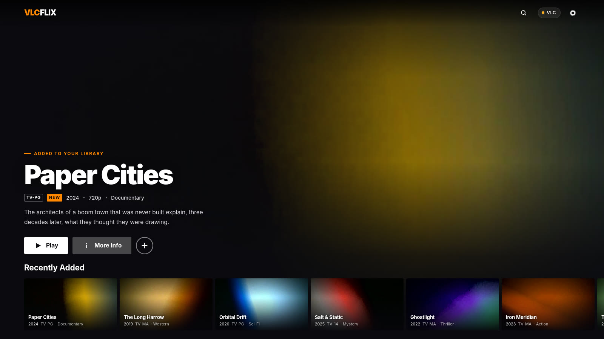
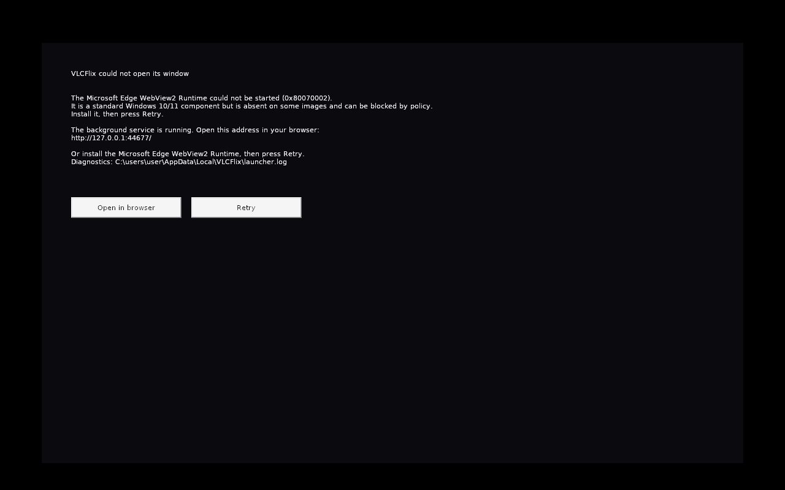

# VLCFlix

A Netflix-style browsing front-end for your own video library that plays through
**the real VLC media player**.

VLC is a superb engine with a functional, unglamorous interface. VLCFlix leaves the
engine alone and replaces the browsing experience: a hero billboard with an autoplay
preview, horizontally scrolling rails, hover-to-preview cards, a detail sheet, search,
My List and resume-watching — while playback is handed to VLC itself over its
documented HTTP control interface.



---

## VLCFlix Studio — the native rewrite (branch `cpp`)

The 1.x application described below is the reference. On branch **`cpp`** the same
product is rewritten from scratch in **C++17** as **VLCFlix Studio**: one native
binary that scans the library, draws every screen with its own software renderer, and
plays films through **libVLC in-process** — no browser, no `vlc.exe`, no HTTP bridge,
so the audited bugs that lived in that machinery (a transcode engine that could not
seek a sparse-keyframe file, an HTTP range server that served suffix ranges from byte
0) have no code path left.

It installs as a **separate application**: `VLCFlixStudio.exe`, its own install
directory, data directory, uninstall entry, AppId and mutex. It never upgrades,
overwrites or migrates 1.x, and the two can be installed side by side.

```bash
cd native
make -j2          # build/vlcflix   (or: cmake -S . -B build && cmake --build build)
make verify       # static checks + 590 tests + 15-step end-to-end journey
make asan         # the same tests under AddressSanitizer
```

**Windows:** hand over one file — **`native/releases/VLCFlixStudio-Setup.exe`**
(git-ignored; a fresh clone builds it with `scripts/build-win-native.sh --setup`).
Double-click it and it installs VLCFlix Studio like any other Windows application:
everything the app needs is inside that one file — the program, SDL2, FreeType,
libpng, zlib, libjpeg, `libvlc.dll`, `libvlccore.dll` and all 29 libVLC plugin
modules — so there is nothing to unzip and nothing else to download. It unpacks into
`%LOCALAPPDATA%\Programs\VLCFlixStudio`, adds a **Desktop icon** and a **Start Menu**
entry, registers itself in **Apps & features** (with its own uninstall entry, icon and
version) and starts the app. Uninstalling removes the program, both shortcuts and the
registry entry, and leaves your library and settings alone.

The same build also leaves a bare **`native/releases/VLCFlixStudio.exe`** for people who
would rather not install: it is the program alone and needs the libraries beside it
from `dist/win-native/VLCFlixStudio-win64.zip`. Either way your data stays in
`%LOCALAPPDATA%\VLCFlixStudio`, beside 1.x rather than over it. Put `ffmpeg.exe` and
`ffprobe.exe` in the install folder (or on `PATH`) if you want durations from files
whose headers are unusual — `doctor` says plainly when they are missing.

**If Windows says the side-by-side configuration is incorrect**, you have a build older
than 2026-10-28: its manifest carried a `description` attribute that Microsoft's schema
does not define, and the loader rejects the whole manifest before the program runs. It
is fixed — the manifest is now schema-checked and has no dependent assemblies at all —
and `scripts/check-win-manifest.py` runs inside `make verify` and inside every Windows
build so it cannot come back.

The current build is **2.0.4** (installer sha256 `e34ff37b987e117502f15c55aa708eec010d319816232d5e64741ea60b38c1fb`): the window shrinks to fit
the screen it opens on, the detail and settings sheets are clickable, the cursor turns into
a hand over anything clickable **on every screen**, a library folder can be chosen with a
folder browser instead of being typed, the window no longer asks a Direct3D 9 driver for
anything (that was crashing 2.0.2 inside the Intel graphics driver before the first frame),
**two-finger touchpad scrolling works**, scrolling moves the page instead of opening a gap
between the hero and the rails, and the hover preview plays the film's preview video with
the card **growing in place** instead of drawing a panel over its neighbours.

**If 2.0.2 crashed instantly** with `code=0xc0000005` in a stack full of `igdumdim64` and
`D3D9`, that is the driver path described above and 2.0.3 is the fix: the renderer is now
chosen by name (software by default) instead of by SDL's own order. `VLCFlixStudio.exe
doctor` prints which one it will use.

Both have been **executed** (under Wine 11.19, on this machine): the installer from a
fresh prefix — install, verify, run the installed app, uninstall — and the app itself:
scanning, artwork, playback, all six screens and the crash log. Running it is what found
the Windows-only bugs a cross build cannot see. What Wine cannot prove — a real display,
real audio, a real Explorer, and a real Add/Remove Programs — is listed in
[`docs/TESTING.md`](docs/TESTING.md) §11, and the zip ships `windows-selfcheck.ps1` to
run the same checks on real Windows.

How it is tested — six layers, a regression test per known bug with its negative
control, and the honest list of what could not be verified here — is
[`docs/TESTING.md`](docs/TESTING.md). What is ported, and what is deliberately not, is
[`native/README.md`](native/README.md).

---

## Windows desktop app

VLCFlix ships as a normal Windows application: **`VLCFlix.exe`**, an installer, and a
desktop icon. There is no bundled browser.

**Download:** `release/VLCFlix-Setup-1.0.0.exe` — or build it yourself with
`scripts/build-win.sh` (see [Building the Windows app](#building-the-windows-app)).

Run the installer and it will:

1. Install to `%LOCALAPPDATA%\Programs\VLCFlix` — **per-user, so no UAC prompt**.
2. Create a **desktop icon** and a Start Menu entry.
3. Register an entry in *Add or remove programs*, including an uninstaller.

Double-click the icon. A native window opens and the app is there.

### Why it is small

| Part | Size | Notes |
|---|---|---|
| `VLCFlix.exe` | 670 KB | Win32 shell: window, server lifecycle, WebView2 host |
| `node.exe` | 67 MB | the bundled runtime — the app's backend is your existing Node server |
| `WebView2Loader.dll` | 165 KB | Microsoft's redistributable loader |
| app + dependencies | 4 MB | server, front-end, demo clips |
| **Installer** | **21 MB** | LZMA-compressed |

The UI renders in **WebView2** — the Chromium-based engine that is already part of
Windows 10 and 11. Nothing Chromium-shaped is bundled, which is the difference between
21 MB and the ~200 MB an Electron app would cost.

If WebView2 is somehow absent (rare; it is a Windows component and ships with Edge),
the app says so plainly instead of failing silently.

### What the shell actually does

1. Picks a free loopback port.
2. Starts `resources\node.exe resources\app\server\index.js` with
   `HOST=127.0.0.1` and `VLCFLIX_DATA_DIR=%LOCALAPPDATA%\VLCFlix`.
3. Polls `/api/health` until it answers, then shows the window.
4. On close, kills the server — enforced with a **job object**, so the background
   process cannot outlive the window even if the app is killed from Task Manager.

Nothing is written into *Program Files*. Settings, watch progress and generated
artwork live in `%LOCALAPPDATA%\VLCFlix`, and survive an uninstall.

### Known cause of the blank window (fixed in 1.0.3)

`ICoreWebView2Controller*` handed to a completion handler is a **borrowed** reference.
Earlier builds stored it raw, so the runtime dropped its own reference the moment the
handler returned, the controller was destroyed, and — per Microsoft's documentation —
"if all references to the controller go away, the WebView is closed". The webview was
therefore torn down microseconds after being created: `Navigate` had already returned
`S_OK` inside the handler, but nothing ever loaded, and any later use of the stale
pointer (a resize, a diagnostic dump) crashed with `0xC0000005`.

The fix is one call: `controller->AddRef()` before storing it, released on teardown.

### If the window stays black

From 1.0.2 the app never shows an unexplained black window. The "Starting VLCFlix..."
label stays on top until the page has actually painted, and if it does not paint
within 8 seconds the shell retries with GPU acceleration switched off
(`--disable-gpu`, the standard remedy for a browser surface that is created but never
draws), then shows the panel below.

Every step is written to `%LOCALAPPDATA%\VLCFlix\launcher.log`:

```
[launch] port    = 58619
[launch] node.exe started, pid=14744
[health] server answered on port 58619 after 800 ms
[webview2] loader = ...\resources\WebView2Loader.dll
[webview2] attempt 0 starting (args='', profile='...\webview')
[webview2] CreateCoreWebView2Controller -> 0x00000000
[webview2] add_NavigationStarting -> 0x00000000
[webview2] Navigate -> 0x00000000
[webview2] watchdog armed for 8000 ms
[webview2] WATCHDOG: no navigation completion after 8000 ms
[webview2] state: visible=1 bounds=1229x651 source=about:blank browserPid=4120
```

That last line is the decisive one: `source=about:blank` means the navigation never
happened, while `bounds=0x0` or `visible=0` would point at the surface itself.

If the embedded browser cannot start, the window shows a **native panel** instead of a
black rectangle: the reason, the local address to open in any browser, a button to do
that, a Retry button, and the log path. The app stays open rather than closing itself.



Most common cause: **the WebView2 runtime is missing** (unusual on Windows 10/11, but it
happens on stripped or LTSC images and some managed machines). Install the
*Microsoft Edge WebView2 Runtime* from Microsoft, then press Retry — no reinstall of
VLCFlix needed.

Logs, both in `%LOCALAPPDATA%\VLCFlix`:

- **`launcher.log`** — paths, port, whether `node.exe` started, the health check, and
  every WebView2 HRESULT.
- **`server.log`** — the Node server's own stdout and stderr.

### Building the Windows app

On Linux or in WSL, with `mingw-w64`, `nsis` and `zip`:

```bash
VERSION=1.0.0 bash scripts/build-win.sh
```

That fetches `node.exe` and the WebView2 SDK into `.cache/`, cross-compiles
`src/win/main.cpp`, assembles `dist/win/VLCFlix/`, and produces the installer and a
portable zip. It is reproducible from a clean checkout.

### Uninstalling

*Settings → Apps → VLCFlix → Uninstall*, or run `Uninstall.exe` in the install folder.
Your library settings are kept; the uninstaller offers to remove them too.

---

## Quick start

Requires **Node.js 18+** and, for full functionality, **VLC** and **ffmpeg**.

```bash
npm install
npm start            # http://localhost:4173
```

On Windows, double-click **`start-windows.bat`** instead — it checks for Node,
installs dependencies on first run, and opens the browser.

Then, in VLCFlix → **Settings**:

1. Add one or more **library folders** (e.g. `D:\Movies`).
2. Press **Scan library**.
3. Press **Play** on anything.

No videos handy? Press **Use the bundled demo library** — eight short procedural
clips ship with the repo (2 MB total) so the UI has something to show immediately.

---

## How playback works

VLC ships an HTTP control interface. Launching it with

```
vlc --extraintf http --http-host 127.0.0.1 --http-port 8080 --http-password <pw>
```

exposes a small REST-ish API that VLCFlix drives:

| Endpoint | Used for |
|---|---|
| `GET /requests/status.xml` | player state, position, length, volume, current title |
| `GET /requests/playlist.xml` | the queue |
| `GET /requests/status.xml?command=…` | `in_play`, `pl_pause`, `pl_stop`, `seek`, `volume` |

When you press play, VLCFlix checks whether VLC is already listening. If it is, it
hands the file to the running instance. If not, it spawns VLC detached with the
control interface enabled, waits for it to answer, and only then reports success.

While VLC plays, a **remote dock** appears in the corner with transport controls,
a scrub bar and live volume — all round-tripping through VLC's own state, so the UI
cannot drift away from what is actually happening in the player.

Every `vlc.exe` call goes through the server. The browser never talks to VLC
directly, which is why the app works when the server runs on a different machine
from the browser.

### Playback engines

Three engines, chosen in **Settings → Playback**:

| Engine | What it does |
|---|---|
| **Real VLC** | Drives your installed `vlc.exe` through its HTTP interface. Most compatible; opens VLC's own window. |
| **FFmpeg** | Pipes the film through `ffmpeg` into the in-app player. Decodes in software by default; hardware decoding is an opt-in switch. |
| **Built-in player** | Serves the file byte-for-byte over a range-aware stream (HTTP 206). Zero CPU. |

**FFmpeg** is for containers and codecs the browser cannot open itself (MKV, AVI,
HEVC, AC3…). If the file is already H.264 the video is **copied, not re-encoded**,
because decoding and re-encoding something the player can already decode is pure
waste. Everything else is transcoded, and decoded in **software** unless you turn
hardware decoding on.

### Hardware decoding (off by default)

Settings → Playback → **Hardware decoding (experimental)**. It is deliberately a
switch you have to find and turn on, because the failure mode is invisible: a GPU
decoder that cannot hand its frames back writes nothing at all, and the viewer sees
a black rectangle rather than an error.

When it is on, each transcode tries a GPU decoder first — QSV, D3D11VA and DXVA2 on
Windows, VideoToolbox on macOS, QSV/VAAPI on Linux — always with an explicit
`hwdownload` step, which is what converts the GPU surface into frames the scaler and
libx264 can actually consume. That step is not optional: without it ffmpeg fails with
*"Impossible to convert between the formats supported by the filter"*, which is what
made v1.1.0–v1.1.10 black.

Every attempt is a trial, never an assumption:

1. the GPU pipe must deliver its first frame within **2.5 seconds**;
2. if it exits early, cannot open the device, or misses that deadline, it is killed and
   the *same request* is served by the software pipe — the film plays either way;
3. a plan proved broken is remembered for the rest of the run, so later seeks do not
   pay for it again, and the ladder retires itself one plan per attempt until only
   software is left;
4. `server.log` records which plan was used: `transcode (hardware qsv -> p010le)` or
   `transcode (software decode)`, and why a hardware plan was abandoned.

If you want to know what your own machine can do before switching it on, run
`tools/hwdecode-probe.cmd` — it is installed with the app and also lives in the source
tree. Double-click it, or drag a film onto it. It runs exactly
these plans against a real file and writes a report saying which ones produce frames.

FFmpeg output is a pipe, so it has no duration and cannot be scrubbed internally.
Seeking there restarts the stream at the new offset; the timeline still shows true
positions because the offset is added back in the UI.

If VLC is missing or refuses to start, VLCFlix falls back to the built-in player
and tells you why, rather than leaving a dead button.

### Subtitles

Drop a subtitle next to the video with the same name and it is picked up
automatically — the convention every player uses:

```
The Silent Coast.mkv
The Silent Coast.srt          -> "Default", switched on
The Silent Coast.en.srt       -> "English"
The Silent Coast.fr.srt       -> "French"
The Silent Coast.forced.srt   -> "Forced"
```

`.vtt` sidecars work the same way. SRT is converted to WebVTT on the fly.

**Subtitles whose names do not match the video** are still offered: the player's
panel lists every subtitle file in the film's folder, name matches first. Picking
one is remembered for that film, so a badly named download only needs selecting
once. VLC finds name-matched files by itself.

### Subtitle and audio sync

Subtitles are drawn by VLCFlix rather than by the browser's `<track>`, because a
native track cannot be retimed, resized or moved. The **CC** button opens a panel
with the track list and four controls:

| Control | Keys (VLC's own) | Notes |
|---|---|---|
| Subtitle delay | **G** earlier · **H** later | 50 ms per press, like VLC; ±60 s range |
| Subtitle size | panel − / + | 50%–250% |
| Subtitle height | panel ↑ / ↓ | distance from the bottom of the picture |
| Audio delay | **J** earlier · **K** later | works in both directions — see below |
| Next track | **V** | cycles through Off and every file |

**Direction, since VLC's own docs disagree:** G shows subtitles earlier, H later;
J plays sound earlier, K later. Every press reports what it did — *"Subtitles
+300 ms (later)"* — so the direction never has to be remembered.

### Audio sync in both directions

A browser can delay sound, but it can never play it *earlier* than the file's own
timeline. That is not a limitation of VLCFlix but of `<video>`.

The way out: **sound 200 ms earlier than the picture** and **picture 200 ms later
than the sound** are the same outcome, and delaying the picture is always possible.
So negative audio offsets are served by holding the picture back, which the player
does by buffering decoded frames and drawing them a little late.

| You press | What happens |
|---|---|
| **K** (sound later) | Web Audio delay node |
| **J** (sound earlier) | picture is held back instead |
| either, at the limit | the other mechanism takes over automatically |

### Automatic latency compensation (Bluetooth)

Bluetooth earbuds deliver sound late — typically 100–300 ms — and the amount drifts
as the link is renegotiated. Turn on **Settings → Playback → Audio latency
compensation** (or the **AUTO** button in the player's CC panel) and VLCFlix:

1. reads the device's reported output latency from the Web Audio `AudioContext`,
2. re-measures every 2.5 s while playing, so a link that changes mid-film is followed,
3. smooths the correction — small drifts are approached gradually so the picture
   does not lurch, while a large change (a different device) is applied at once,
4. holds the picture back by exactly that amount.

**It is independent of your manual offset.** The automatic correction always lives
on the picture side, so the manual control stays at 0 ms and remains yours to use;
press **J** and your offset is added on top of the device correction rather than
fighting it. Turning the manual control back to zero leaves the Bluetooth correction
intact.

Two caveats worth stating: the measurement only exists while sound is actually
flowing through the player (so it reports `measuring…` before playback starts), and
this applies to the in-app engines only — Real VLC manages its own output and has
its own `Ctrl+T` track synchronisation dialog.

### Player gestures

The picture is split into three invisible bands, so a click means what its position
says it means:

| Where | One click | Two quick clicks |
|---|---|---|
| the play / pause button itself | play / pause | play / pause |
| middle third, beside the button | keeps the controls up — never pauses | with the controls hidden, the first tap brings them back and the second toggles |
| left third | show or hide the controls | rewind 10 s |
| right third | show or hide the controls | skip forward 10 s |

Only the button toggles playback: a stray click anywhere else on the picture —
including right next to the button — leaves the film running. (In v1.1.7–v1.1.12
the whole middle third toggled; the target is now the 84 px icon itself.)

Seeking **replaces** the stream offset instead of appending a second one, so a
film you resumed mid-way seeks to where you ask rather than restarting from zero. A skip is confirmed on screen with a `+10 s` / `−10 s` badge
over the side it applies to, so the feedback never hides the centre icon.

Moving the mouse brings the controls back at any time, from wherever the pointer is.

Subtitle and sync settings persist across sessions.

Bitrate, size and resolution are unchanged; the subtitle is read, not copied.

---

## When a stream fails

The **FFMPEG** engine pipes the film through ffmpeg, decoding in **software**.
Hardware decode (`-hwaccel qsv` / `d3d11va`) is deliberately not used: those
decoders hand the filter chain frames in a GPU pixel format such as `qsv`, which
neither the scaler nor the H.264 encoder can consume, so ffmpeg exits with
*"Impossible to convert between the formats supported by the filter"* and writes
nothing — a black screen. Software decode always produces frames the encoder can
take.

If that pipe fails anyway — an
ffmpeg build without `libx264`, a codec it will not transcode, a stream that never
produces a picture — VLCFlix does not leave you looking at a black rectangle:

1. the player retries the film **directly from the file**, which the built-in
   player decodes, and keeps your position;
2. a short message says the built-in player was used instead;
3. if the file will not play that way either, the reason is put on the screen
   (*"the video could not be decoded"*) instead of nothing;
4. while there is no picture the controls stay on screen, and the **back arrow is
   never hidden at all** — a black player never hides the way out;
5. moving the mouse anywhere in the window brings the controls back, not only
   over the picture;
6. the controls paint **above** the latency canvas, so they stay usable while the
   picture is being held back for audio sync.

A pipe that produces no picture within 7 seconds counts as failed, so a silent
hang is treated the same as an error. `server.log` in `%LOCALAPPDATA%\VLCFlix`
records ffmpeg's own words for the failure.

## What happens on a scan

Scanning runs in **two phases**, because reading a file and drawing it cost wildly
different amounts of time. On a measured run over eight clips: the library was
browsable after **685 ms**, and artwork finished **8.3 s later in the background**.

1. **Phase 1 — read (fast).** Every file is stat'd and probed with `ffprobe` for
   duration, resolution and codecs. Six files are read at a time and no pixels are
   touched, so the grid fills in within a second or two even on a large library.
   The catalog is published here, so you can start browsing immediately.
   **The scan is not tied to the Settings panel.** It is a server-side job, and a
   small indicator in the header — *"Artwork 40/113 · 35%"* — shows it is alive
   while you browse; clicking it reopens the panel. The grid refreshes as artwork
   lands, so thumbnails appear while you scroll instead of all at once.
   Upgrading never leaves stale artwork: on startup VLCFlix checks the stored
   catalogue and, if any film has no artwork or a preview from an older format,
   refreshes those in the background without being asked. Artwork URLs carry a
   version, so a re-rendered clip is never served from the browser's cache.
2. **Phase 2 — draw (background).** Posters and backdrops are rendered two at a
   time and the catalog is republished as they land. The settings panel reads
   *"Library ready — drawing artwork 40/113"*, and cards fill in while you scroll.

Previously both phases ran in one pass, one file at a time, so nothing appeared
until the last thumbnail was written — the difference between waiting two minutes
and waiting two seconds. For each video, phase 2:

- **Generates three assets** with `ffmpeg`:
   - `poster.jpg` — 400×600 crop, for grid views
   - `backdrop.jpg` — 1280×720 crop, for the hero and cards
   - `preview.mp4` — a montage: five 2-second snippets across the film
     (12%, 32%, 52%, 72%, 90%) concatenated into one 10-second muted clip, so the
     preview shows the film changing rather than one frozen moment
- **Grades each still** (contrast, saturation, vignette) and then **measures its
  mean luma** using ffmpeg's `signalstats`, correcting exposure with a gamma curve
  if the frame is too dark or too flat for white text to sit on. A dark opening
  scene would otherwise produce an unreadable card.

Titles and years are parsed out of filenames in phase 1, stripping release tags
(`1080p`, `x265`, `WEB-DL`, …), as are sidecar subtitles.

Unchanged files are skipped on later scans via an id/size/mtime check, so
re-scanning a large library is cheap.

Artwork is written to `data/media/`. VLCFlix reads your videos and never moves,
renames or deletes them.

### Artwork is drawn once, and never twice

Artwork lives in `%LOCALAPPDATA%\VLCFlix\media` (or `data/media` when run from
source), next to the catalogue, so it survives closing the app and installing a
new version over the old one. On every launch VLCFlix compares the catalogue
against **the files actually on disk**:

| On launch | What happens |
|---|---|
| every film has its three files | nothing at all; the grid is instant |
| some films are missing files | only those are drawn, straight from the catalogue — **the library is not rescanned** and no file is probed twice |
| the app was closed mid-pass | the films already drawn are kept and the pass resumes from the next one |
| a file was deleted, or the catalogue lost track of it after a crash | that file is detected and redrawn |

A file is written under a temporary name and renamed only when it is complete,
so an interrupted run can never leave a half-written poster that later looks
finished. Artwork files are versioned by the format that produced them, which is
what triggers a one-off re-render when the format itself changes between
releases — never on an ordinary restart.

Drawing never competes with the window: the page tells the server when it has
painted, and the artwork pass starts only then (or after 20 s if the window never
reports in). Before that gate, a launch with artwork to finish could keep the
first paint waiting long enough for the launcher to give up on it.

A film that cannot be read (a damaged file, or a drive that is not connected) is
attempted at most three times and then left alone with the reason recorded, so
one bad file cannot make every launch look like it is starting over. Press
**Scan library** to retry it deliberately.

### Sidecar metadata

Filenames are a poor place for real metadata. Drop a JSON file beside any video
with the same base name to override everything:

```json
// The.Long.Harrow.2019.mkv  ->  The.Long.Harrow.2019.json
{
  "title": "The Long Harrow",
  "year": 2019,
  "rating": "TV-MA",
  "genres": ["Western", "Drama"],
  "accent": "#b5651d",
  "synopsis": "Two brothers split a failing ranch down the fence line..."
}
```

`accent` is used for fallback artwork when ffmpeg is unavailable.

---

## Configuration

Stored in `data/settings.json`, editable from the Settings sheet:

| Key | Meaning |
|---|---|
| `libraryFolders` | absolute paths scanned for videos |
| `playMode` | `vlc`, `ffmpeg` or `browser` |
| `vlcPath` | VLC executable; empty = auto-detect |
| `vlcHttpPort` | port for VLC's control interface (default 8080) |
| `vlcPassword` | required, because VLC refuses to open the interface without one |
| `playMode` | `vlc` or `browser` |
| `vlcFullscreen` | fullscreen when VLC starts |

Auto-detection covers `C:\Program Files\VideoLAN\VLC\vlc.exe`,
`C:\Program Files (x86)\...`, `/Applications/VLC.app/Contents/MacOS/VLC`, and
`vlc` on `PATH`. `VLCFLIX_VLC_PATH` overrides it.

---

## API

| Method | Route | Purpose |
|---|---|---|
| GET | `/api/bootstrap` | everything the UI needs on load |
| GET | `/api/catalog` | items with progress and list state |
| POST | `/api/library/scan` | start a scan (202) |
| GET | `/api/scan/status` | scan progress and phase, polled by the UI |
| GET | `/api/subtitles/:id/:index` | sidecar subtitle as WebVTT |
| POST | `/api/settings` | validated partial update |
| GET | `/api/system` | platform, ffmpeg availability, VLC detection |
| POST | `/api/player/play` | play an item in VLC or the browser |
| GET | `/api/player/status` | live VLC state |
| POST | `/api/player/command` | pause, resume, toggle, stop, seek, seekBy, volume |
| POST | `/api/progress` | save a resume point |
| POST | `/api/mylist` | toggle an item in My List |
| GET | `/api/stream/:id` | range-aware local stream (206); `?engine=ffmpeg&t=SECONDS` transcodes through ffmpeg |

---

## Tests

```bash
npm test
```

23 tests over the parsers and the HTTP surface. The parser fixtures in
`tests/fixtures/` are **real captured output from VLC 3.0.24**, not hand-written
XML — so the tests fail if VLC's format and the parser ever disagree. The API
tests run against a throwaway data directory and never touch your library.

---

## Verified against

- VLC **3.0.24 Vetinari** (Debian build): `status.xml`, `playlist.xml` parsing;
  `in_play`, `pl_pause`, `seek`, `volume` commands; password rejection (401).
- Node.js 20.
- Chromium: full UI, built-in player, hover previews, detail sheet.

## Known limitations

Stated plainly rather than discovered later:

- **The UI is a companion app, not a patched `vlc.exe`.** This sandbox cannot
  build VLC for Windows (2 cores, 2 GB RAM, no mingw-w64 toolchain) — and a
  cross-compiled Windows binary could not be run or verified here. VLCFlix
  therefore drives VLC rather than replacing its Qt/QML interface. The product
  behaviour — Netflix-style browsing with playback in VLC — is real and tested.
- **The built-in player depends on browser codecs.** Chromium builds without
  proprietary codecs cannot play H.264; use VLC for those files.
- **Playback state is polled, not pushed.** VLC's HTTP interface has no event
  stream, so the remote dock refreshes every 2 seconds. Seeks can take up to that
  long to appear.
- **One VLC instance per port.** Two VLCFlix windows pointed at the same port share
  one player.
- **Artwork comes from the video itself.** There is no online metadata lookup, so
  a film with no sidecar file is titled from its filename.
- **No authentication.** VLCFlix binds to `0.0.0.0` and has no login. Run it on a
  trusted network, or change `app.listen` to `127.0.0.1` if that matters.
